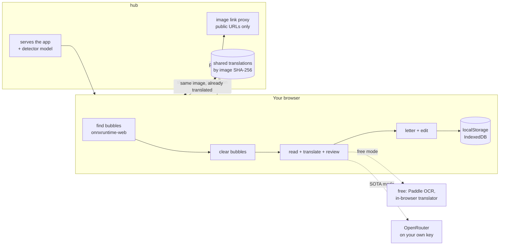

# comic-translator

Drop a comic strip. It finds the bubbles, clears them, translates them, reviews the result with LLMs, and letters it back. Every bubble stays editable by hand.

Live: https://comic.tmpx.space

## How it works

The whole pipeline runs in the browser. The server (the hub) never sees your key, never runs a model, and never stores an image.



- **Free mode**: everything stays on your computer. Rougher.
- **SOTA mode**: bubble text goes to the model through OpenRouter on your key (about $0.05–0.15 a strip). The key lives in localStorage.
- **Sharing** (optional): posts the image hash and the translation file, never the image. Anyone who opens the same image gets the shared translations.

## Code

| dir | what |
|---|---|
| `frontend/` | Solid + Vite app, the whole pipeline (`src/lib/cv`, `src/lib/llm`) |
| `hub/` | Go, stdlib + sqlite: static files, shared translations, image proxy |
| `bench/` | OCR / LLM benchmarks |
| `docs/` | design notes |

## Run

```sh
cp .env.example .env   # deploy host, cache dir
just serve             # hub :4750 + vite :4721
just check             # tsc + go vet + tests
just deploy            # build, ship to $DEPLOY_HOST
```

## License

AGPL-3.0
